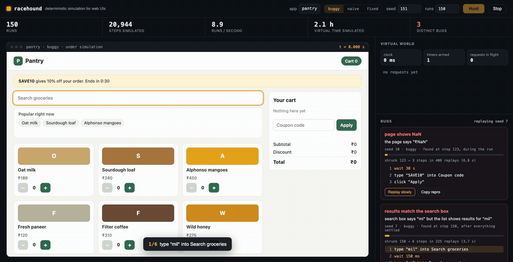
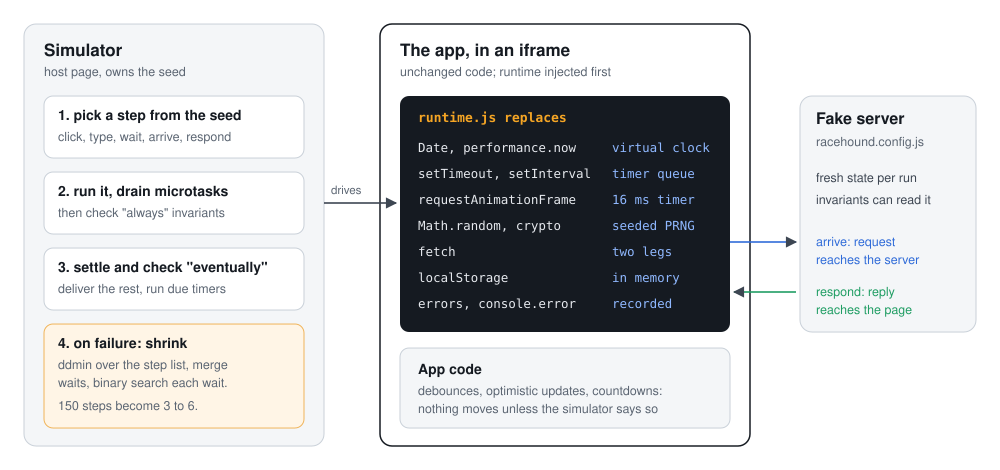

# Racehound

**Deterministic simulation testing for web UIs.**

Racehound runs your frontend inside a simulation. Time, timers, randomness, storage and the network are fake, and the simulator moves them one step at a time. Each run is a single seed. When a run breaks a rule, Racehound shrinks it to the fewest steps that still break it. You get a short, exact repro you can replay forever.

FoundationDB and TigerBeetle test their databases this way. Racehound applies the same idea to the async code in a web page: debounces, optimistic updates, countdowns, and responses that come back in the wrong order.



*Replay of a bug it found. Type `mil`, then `mi`. The `mi` response arrives first, then the stale `mil` response lands on top. The box says `mi`, the list shows `mil`.*

---

## What it found in the demo app

`demo/pantry` is a small grocery store in plain JavaScript, written the way first drafts usually are. Racehound has no idea where the bugs are. You give it an empty fake server and three rules, and it hunts.

```
$ node bin/racehound.mjs hunt demo/pantry --variant buggy --runs 300
300 runs, 42296 steps, 12.6 s, variant buggy

BUG  cart matches the server
     page shows 0 x coffee, server has 1
     seed 2, 3 steps:
      1. click "Add Filter coffee"
      2. click "Remove Filter coffee"
      3. server receives POST /api/cart {"sku":"coffee","delta":-1} #1

BUG  results match the search box
     search box says "mi" but the list shows results for "mil"
     seed 7, 6 steps:
      1. type "mil" into Search groceries
      2. wait 150 ms
      3. type "mi" into Search groceries
      4. wait 150 ms
      5. server receives GET /api/search?q=mi #1
      6. response to GET /api/search?q=mi #1 reaches the page

BUG  page shows NaN
     the page says "₹NaN"
     seed 10, 3 steps:
      1. wait 30000 ms
      2. type "SAVE10" into Coupon code
      3. click "Apply"
```

Each failing run was about 120 to 150 steps long before shrinking. All three bugs are ordinary:

| Bug | What went wrong | Minimal repro |
| --- | --- | --- |
| Cart drifts from the server | The page trusts whichever reply comes back last. "Remove" reached the server before "Add", so the server clamped at 0 and then added 1. | 3 steps |
| Stale search results | Debounced search, no cancellation. An older response overwrites a newer one. | 6 steps |
| `₹NaN` total | When the coupon countdown ends it deletes the coupon, but Apply still accepts the code. Thirty seconds of virtual time pass in one step. | 3 steps |

### The obvious fix was wrong

The `naive` variant applies the fix most people reach for first: ignore replies to anything except the newest request. Racehound broke it in 3 steps:

```
$ node bin/racehound.mjs hunt demo/pantry --variant naive
BUG  cart matches the server
     page shows 1 x mangoes, server has 2
     seed 1, 3 steps:
      1. click "Add Alphonso mangoes"
      2. click "Add Alphonso mangoes"
      3. server receives POST /api/cart {"sku":"mangoes","delta":1} #2
```

The second request reached the server first. The server answered it with a quantity of 1, then processed the first request and stored 2. The page kept the "newest" reply, 1, and threw away the correct one. The `fixed` variant has the server return a version number, and the page applies a reply only if its version is newer than the last one it applied. That holds for any message order.

### Numbers

From `scripts/eval.mjs`: 1,000 seeds per variant, 150 steps per run, headless Chrome on a laptop.

| Variant | Runs that failed | Steps | Virtual time | Runs per second | Seed replays identical |
| --- | --- | --- | --- | --- | --- |
| buggy | cart 242, NaN 162, search 58 | 141,875 | 14.6 h | 38.8 | 50 / 50 |
| naive | cart 502 | 149,760 | 15.6 h | 41.2 | 50 / 50 |
| fixed | **0** | 149,757 | 15.5 h | 35.8 | 50 / 50 |

"Seed replays identical" means each of the first 50 seeds was run twice, and both runs produced exactly the same steps, failure and final virtual clock. Raw data is in [`docs/results.json`](docs/results.json).

---

## How it works



**1. A virtual world inside the page.** The app loads in an iframe with [`src/runtime.js`](src/runtime.js) injected as its first script, so your code doesn't change. The runtime replaces:

- `Date` and `performance.now` with a virtual clock that starts at a fixed epoch;
- `setTimeout`, `setInterval` and `requestAnimationFrame` with a timer queue that only fires when the simulator advances time;
- `Math.random`, `crypto.getRandomValues` and `crypto.randomUUID` with a seeded PRNG;
- `fetch` with simulated network messages;
- `localStorage` and `sessionStorage` with in-memory stores.

Uncaught errors, unhandled rejections and `console.error` calls are recorded.

**2. A network with two legs.** Every `fetch` becomes a message the simulator moves in two separate steps. In `arrive`, the request reaches the fake server and changes its state. In `respond`, the reply reaches the page. Requests can arrive at the server in any order, and replies can return in any order. That is how it broke the naive fix: the requests themselves were reordered, not just the replies. `AbortController` works: an aborted request can still reach the server, but its reply is thrown away.

**3. Steps are data.** A run is a seed plus a list of steps: `click`, `input`, `select`, `tick`, `arrive`, `respond`, and `fail` when fault injection is on. The seed decides which step comes next. After each step the simulator lets the page's microtasks finish, then checks the rules. A step that no longer makes sense during a replay is skipped, for example when its element or request doesn't exist. That is what lets the shrinker delete steps freely.

**4. Two kinds of rules.** `always` rules are checked after every step. `eventually` rules are checked after the run settles: everything still in flight is delivered and due timers run. "Results match the search box" is an `eventually` rule because it's fine for the list to lag behind while you type, but not forever. Three checks need no setup:
- uncaught errors and `console.error`;
- unhandled rejections;
- `NaN`, `undefined`, `[object Object]` or `Infinity` in the visible text.

**5. Shrinking.**
- Racehound runs delta debugging (Zeller and Hildebrandt, 2002) over the step list.
- It folds all the waiting into a single wait.
- It binary-searches each wait down to the shortest one that still fails.
- A last pass removes one step at a time, so no single step can be dropped without losing the bug.

A candidate only counts if it fails the *same* rule, so the shrinker can't drift onto a different bug. Requests are named by their content, not by their position. Deleting an unrelated click therefore doesn't rename the request a later step refers to.

---

## Use it

Requires Node 18 or newer and Google Chrome or Chromium.

```bash
npm install
npm run ui                                        # open the UI at http://127.0.0.1:4177
node bin/racehound.mjs hunt demo/pantry --variant buggy    # hunt headless, exit 1 on a bug
node bin/racehound.mjs hunt demo/pantry --out repros       # save each bug as JSON
node bin/racehound.mjs replay repros/buggy-page-shows-NaN.json   # exit 1 while it still fails
npm test                                          # unit tests plus end-to-end tests in headless Chrome
```

A saved repro is a regression test. `racehound replay` exits 1 while the bug is still there and 0 once it's fixed. The CI workflow runs the test suite in headless Chrome on every push.

### Testing your own app

Put a `racehound.config.js` next to your `index.html`:

```js
export default {
  entry: 'index.html',

  // A fresh fake backend for every run.
  server() {
    const state = { todos: [] };
    return {
      state,
      routes: {
        'GET /api/todos': () => state.todos,
        'POST /api/todos': ({ body }) => { state.todos.push(body); return { ok: true }; },
      },
    };
  },

  // What to type into which field, by CSS selector (ids work best).
  inputs: { '#new-todo': ['milk', 'eggs', ''] },

  // Rules. Return true when they hold, or a string that explains what went wrong.
  always: {
    'counter matches the list': ({ $, $$ }) =>
      Number($('#count').textContent) === $$('li').length || 'counter is off',
  },
  eventually: {
    'page agrees with the server': ({ $$, server }) =>
      $$('li').length === server.todos.length || `page ${$$('li').length}, server ${server.todos.length}`,
  },

  // Optional: run several versions of the code, and drop network messages.
  variants: { main: {} },
  faults: false,
  settle: 5000,
};
```

Then run `node path/to/racehound/bin/racehound.mjs hunt path/to/app` from your project folder. The CLI serves the current folder, so the app has to be inside it.

---

## Limitations

This is a prototype. It is honest about what it fakes:

- **Only `fetch` is simulated.** `XMLHttpRequest`, WebSocket, EventSource, workers and `postMessage` are not virtualized yet. Code that uses them runs on real time.
- **Events are synthesized** with `el.click()` and `input` events, not real mouse and keyboard input, so CSS `:hover` and focus-dependent behavior aren't exercised.
- **CSS animations and transitions** run on the real clock.
- **Same-origin apps only.** The app is loaded with `srcdoc` and a `<base>` tag, and module scripts are fetched for real.
- **The fake server is yours to write,** and bugs that only show up with real backend latency or real database behavior are out of scope.
- **The step generator is uniform random** with fixed weights. It has no coverage guidance. The demo bugs show up in 6 to 50 percent of runs. A rarer bug in a bigger app could need many more runs or smarter generation.

## Prior art

- **FoundationDB's simulation testing and TigerBeetle's VOPR.** Deterministic simulation of whole distributed systems. The inspiration here.
- **Antithesis.** A deterministic hypervisor that makes this work for unmodified software.
- **Jepsen.** Fault injection plus history checking for distributed databases.
- **QuickCheck and Hypothesis.** Random testing with shrinking.
- **fast-check's `scheduler`.** Reorders promise resolution inside unit tests, the closest thing to this in the JavaScript world.
- **Delta debugging.** A. Zeller and R. Hildebrandt, "Simplifying and Isolating Failure-Inducing Input", IEEE TSE, 2002.

Racehound puts these together for a whole page in a browser: it controls the page's time, network and randomness from outside, and shrinks failing runs to minimal step lists.

## Layout

```
src/runtime.js   in-page virtual world (clock, timers, PRNG, fetch, storage)
src/sim.js       simulator: step generation, execution, invariants, settling, shrinking
src/ddmin.js     delta debugging
src/prng.js      seeded PRNG
src/node.mjs     static server + headless Chrome helper
ui/              hunting and slow-replay UI
bin/             CLI
demo/pantry/     demo app with buggy, naive and fixed variants
scripts/eval.mjs measurements behind the numbers table
test/            unit and end-to-end tests
```

## License

MIT
